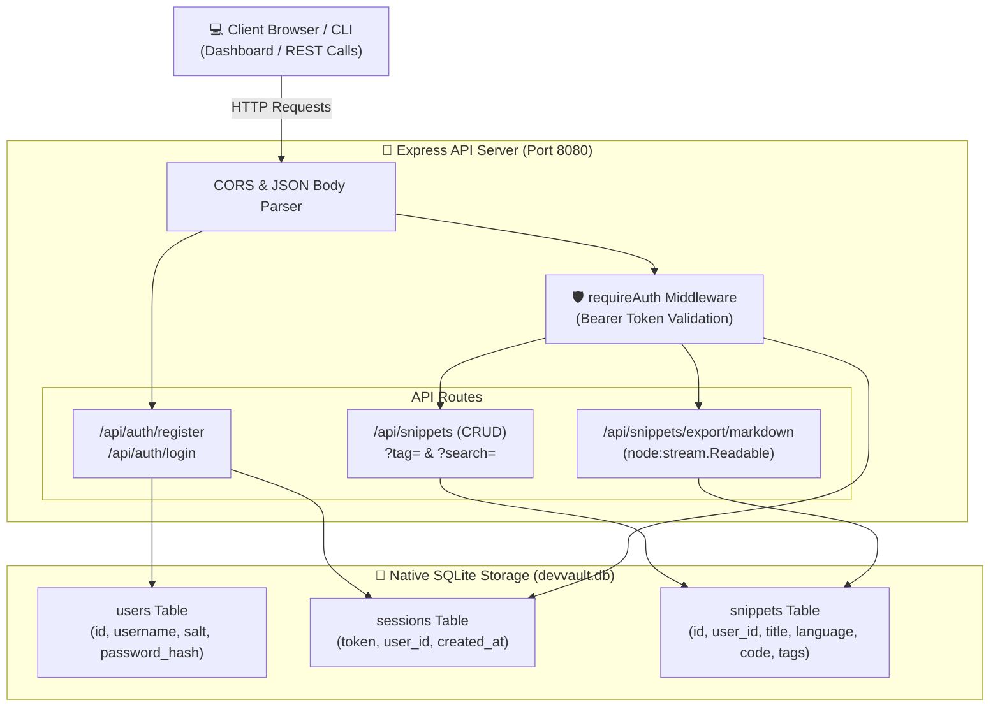

# 🗄️ DevVault — Developer Snippet & Secrets Manager

[](https://nodejs.org/)
[](https://expressjs.com/)
[](https://nodejs.org/api/sqlite.html)
[](https://nodejs.org/api/crypto.html)
[-F7DF1E?logo=javascript&logoColor=black)](https://nodejs.org/api/esm.html)

A secure, full-stack developer snippet manager and secrets vault built with modern **Node.js (ES Modules)**, **Express**, embedded **SQLite (`node:sqlite`)**, and **Cryptographic Authentication**. 

Includes a responsive, GitHub-styled dark-mode web dashboard and an asynchronous **Streaming Markdown Exporter**.

---

## 🏛️ System Architecture



---

## ✨ Core Features & Engineering Highlights

- **Cryptographic Password Security:** Passwords are never stored in plain text. Each user is provisioned with a 16-byte cryptographically secure salt via `node:crypto.randomBytes` and hashed using memory-hard `scrypt` (`crypto.scryptSync`).
- **Session-Based Bearer Token Auth:** Generates secure 32-byte hex session tokens on login/register. The `requireAuth` middleware verifies incoming `Authorization: Bearer <token>` headers before granting access to protected routes.
- **Native Embedded Database:** Zero-dependency relational database using Node.js's native `node:sqlite` engine (`DatabaseSync`) with foreign key constraints.
- **Dynamic Search & Filtering:** Filter snippets by tag (`?tag=node`) or perform real-time full-text search across titles and code bodies (`?search=query`).
- **High-Performance Streaming Export:** Exports a user's entire code vault as a downloadable `.md` file using `node:stream.Readable`, streaming chunks straight into the HTTP response with minimal memory footprint.
- **Embedded Dark-Mode UI:** Zero-dependency frontend served statically from `public/index.html` with real-time DOM updates, syntax-tagged snippet cards, and one-click export.

---

## 📡 REST API Reference

### 1. Authentication Endpoints

| Method | Endpoint | Description | Auth Required | Request Body |
| :--- | :--- | :--- | :---: | :--- |
| `POST` | `/api/auth/register` | Register a new user account | ❌ No | `{ "username": "...", "password": "..." }` |
| `POST` | `/api/auth/login` | Authenticate and obtain Bearer token | ❌ No | `{ "username": "...", "password": "..." }` |

### 2. Snippet Vault Endpoints

| Method | Endpoint | Description | Auth Required | Request Body / Params |
| :--- | :--- | :--- | :---: | :--- |
| `GET` | `/api/snippets` | List snippets (supports `?tag=` & `?search=`) | ✅ Bearer Token | Query Params |
| `POST` | `/api/snippets` | Create a new snippet in the vault | ✅ Bearer Token | `{ "title": "...", "language": "...", "code": "...", "tags": "..." }` |
| `DELETE` | `/api/snippets/:id` | Delete a snippet by its unique ID | ✅ Bearer Token | URL Parameter `:id` |
| `GET` | `/api/snippets/export/markdown` | Stream all snippets as a Markdown file download | ✅ Bearer Token | None (triggers file download) |

---

## 🗄️ Database Schema

```sql
-- Users Table
CREATE TABLE users (
  id INTEGER PRIMARY KEY AUTOINCREMENT,
  username TEXT UNIQUE NOT NULL,
  salt TEXT NOT NULL,
  password_hash TEXT NOT NULL,
  created_at DATETIME DEFAULT CURRENT_TIMESTAMP
);

-- Active User Sessions
CREATE TABLE sessions (
  token TEXT PRIMARY KEY,
  user_id INTEGER NOT NULL,
  created_at DATETIME DEFAULT CURRENT_TIMESTAMP,
  FOREIGN KEY(user_id) REFERENCES users(id)
);

-- Code Snippets Table
CREATE TABLE snippets (
  id INTEGER PRIMARY KEY AUTOINCREMENT,
  user_id INTEGER NOT NULL,
  title TEXT NOT NULL,
  language TEXT NOT NULL,
  code TEXT NOT NULL,
  tags TEXT, -- Comma-separated (e.g. "javascript,node,streams")
  created_at DATETIME DEFAULT CURRENT_TIMESTAMP,
  FOREIGN KEY(user_id) REFERENCES users(id)
);
```

---

## 🚀 Quick Start Guide

### 1. Install Dependencies
```bash
npm install
```

### 2. Start DevVault Server
```bash
npm run devvault
```
The server will initialize the SQLite database and start listening:
```text
DevVault SQLite Database initialized at: ...\database\devvault.db
~DevVault is running at 8080
```

### 3. Open the Dashboard
Open your browser and navigate to:
```text
http://localhost:8080
```

---

## 🧪 Automated End-to-End Test Suite

Run the companion integration test client to verify registration, login, snippet creation, tag search, and streaming export:

```bash
npm run test:vault
```

**Expected Output:**
```text
--- 1. Testing Registration (POST /api/auth/register) ---
Registration Status: 201 (Password salted & hashed)

--- 2. Testing Snippet Creation (POST /api/snippets) ---
Create Snippet Status: 201 (Saved to SQLite)

--- 3. Testing Snippet Search (GET /api/snippets?search=Pipeline) ---
Search Status: 200 (Found: 1)

--- 4. Testing Streaming Markdown Export (GET /api/snippets/export/markdown) ---
Export Status: 200 (Content-Type: text/markdown)

🎉 ALL DEVVAULT CAPSTONE TESTS PASSED PERFECTLY!
```

---

## 📁 Project Directory Structure

```text
Project-DevVault/
├── database/
│   ├── db.js                 # Native node:sqlite schema definition
│   └── devvault.db           # SQLite database file
├── public/
│   └── index.html            # Dark-mode developer dashboard
├── auth.js                   # Salt + Scrypt hashing & requireAuth guard
├── server.js                 # Express server, CRUD routes & Markdown stream
├── test-client.js            # Automated integration test runner
└── readme.md                 # Project documentation
```
