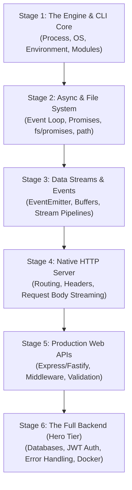

# Node.js Zero-to-Hero Master Roadmap

A hands-on, test-driven curriculum designed to take you from foundational concepts to building production-grade backend systems.
Zero To Hero
---

## 🗺️ The 6-Stage Curriculum

---

### Stage 1: The Engine & CLI Core
- **Mental Model:** How Node boots, reads `process.argv` and `process.env`, and connects modular files (`import` / `export`).
- **Concepts:** `process`, `os`, `node:path`, ECMAScript Modules (`type: "module"`).
- **Your Hands-On Project:** **CLI File & System Inspector** (A command-line tool that accepts arguments, reads system stats, and resolves paths safely).

---

### Stage 2: Asynchronous Mastery & Non-Blocking I/O
- **Mental Model:** The Single Waiter, Libuv Thread Pool, Microtasks vs Macrotasks.
- **Concepts:** `async` / `await`, `node:fs/promises`, error handling with `try...catch`.
- **Your Hands-On Project:** **Desktop File Sorter** (Scans a messy folder and asynchronously sorts files into `/images`, `/docs`, `/code` without freezing the process).

---

### Stage 3: Binary Data, Events & Streams
- **Mental Model:** Water pipes vs buckets. How to process gigabytes of data with 30MB of RAM.
- **Concepts:** `EventEmitter`, `Buffer`, `createReadStream`, `createWriteStream`, `stream.pipeline`.
- **Your Hands-On Project:** **Streaming Log Analyzer & Word Counter** (Streams a large server log file chunk-by-chunk and counts error frequencies).

---

### Stage 4: Native HTTP Server (No Frameworks)
- **Mental Model:** The anatomy of the web. Understanding what libraries like Express actually do behind the curtain.
- **Concepts:** `node:http`, Status codes (`200`, `400`, `404`), Headers, URL routing, Parsing incoming JSON body chunks.
- **Your Hands-On Project:** **Zero-Dependency Note API** (A full REST API supporting `GET`, `POST`, and `DELETE` without installing any third-party packages).

---

### Stage 5: Production Web APIs (Express / Fastify)
- **Mental Model:** The Middleware Assembly Line (Request -> Auth -> Validation -> Handler -> Response).
- **Concepts:** `npm install`, route controllers, schema validation, global error handling.
- **Your Hands-On Project:** **Products & Inventory REST API** (Clean architecture, input validation, proper HTTP error codes).

---

### Stage 6: The Hero Tier (Database, Auth & Security)
- **Mental Model:** Persistent state, cryptography, and containerized deployment.
- **Concepts:** SQLite / PostgreSQL, Password Hashing (`node:crypto`), JWT authentication, CORS, environment security.
- **Your Capstone Project:** **Secure User Authentication & Notes Vault API**.

